# Einleitung

::: {.content-visible when-format="html"}
Diese Dokumentation gibt es auch als [PDF zum Ausdrucken](dokumentation.pdf).
:::

## Aufgabenstellung

Die Angabe gliedert sich in sechs Teile:

| Part | Inhalt | Umsetzung |
|---|---|---|
| 1 | Klassen `Neuron`, `Layer`, `NeuralNetwork`; Forward, Backpropagation, Training; Export als JSON, TXT und C-Header | Paket `nn/` |
| 2 | XOR (2-2-1) und 7-Segment-Decoder (4-16-7) trainieren, exportieren, wieder laden und prüfen | `train_*.py`, `test_*_load.py` |
| 3 | Dieselben Netze mit TensorFlow trainieren und vergleichen | `compare_tensorflow.py` |
| 4 | Forward-Pass in C, Gewichte aus der `.txt`-Datei | `c_forward/` |
| 5 | Forward-Pass in C, Gewichte aus dem `.h`-Header | `c_header_init/` |
| 6 | Portierung auf einen ESP32 mit 7-Segment-Anzeige | ersetzt durch eine interaktive Web-Visualisierung |

: Teile der Angabe und ihre Umsetzung {#tbl-parts}

::: {.callout-note}
## Planänderung Part 6
Ein ESP32-Board stand nicht zur Verfügung. Part 6 wurde deshalb durch eine interaktive
HTML-Seite ersetzt, die denselben Zweck erfüllt: sichtbar machen, dass das trainierte Netz
wirklich dekodiert. Die Seite rechnet mit den exportierten Gewichten selbst, es gibt keine
hinterlegte Wahrheitstabelle (@sec-visualisierung).
:::

## Ergebnisse auf einen Blick

| Teil | Ergebnis |
|---|---|
| Part 1: Backpropagation | Gradient-Check gegen numerische Ableitung: Abweichung 7·10⁻¹¹ |
| Part 1: Export | JSON, TXT und Header speichern die Gewichte bit-exakt |
| Part 2: XOR 2-2-1 | 4/4 richtig, Kosten 9,6·10⁻⁴, Abweichung nach dem Laden: 0 |
| Part 2: 7-Segment 4-16-7 | 70/70 Segmente, 10/10 Ziffern, Abweichung nach dem Laden: 0 |
| Part 3: TensorFlow | mit gleichen Startgewichten identisch bis 1,4·10⁻¹⁶ |
| Part 4 und 5: C | 70/70, Abweichung zu Python 2,2·10⁻¹⁶ |
| Part 6 (Ersatz): Visualisierung | rechnet im Browser bit-identisch zu C |
| Bonus | ReLU/tanh, Mini-Batch, Momentum, 70 automatische Tests |
| Erweiterung | Ziffernerkennung auf MNIST: 97,7 % auf 10 000 Testbildern |

: Zusammenfassung {#tbl-ergebnisse}

# Theorie {#sec-theorie}

## Aufbau des Netzes

Das Netz der Angabe hat zwei Schichten mit Gewichten. Die Eingabe $X$ (auch $A^{[0]}$) ist
keine eigene Schicht, sie wird nur weitergereicht. $A^{[1]}$ ist die Hidden-Schicht,
$A^{[2]} = \hat{Y}$ die Ausgabe. Die Zahl in eckigen Klammern ist die Nummer der Schicht.

## Forward-Pass

Jede Schicht bildet zuerst eine gewichtete Summe und wendet dann eine nichtlineare
Aktivierungsfunktion an:

$$
\begin{aligned}
Z^{[1]} &= W^{[1]} X + b^{[1]}, & A^{[1]} &= \sigma\left(Z^{[1]}\right)\\
Z^{[2]} &= W^{[2]} A^{[1]} + b^{[2]}, & A^{[2]} &= \sigma\left(Z^{[2]}\right) = \hat{Y}
\end{aligned}
$$ {#eq-forward}

Als Aktivierung dient die Sigmoid-Funktion. Ihre Ableitung lässt sich allein aus der Ausgabe
$a$ berechnen; das nutzt der Code, um $e^{-z}$ nicht ein zweites Mal auszurechnen:

$$
\sigma(z) = \frac{1}{1 + e^{-z}}, \qquad \sigma'(z) = \sigma(z)\,\bigl(1 - \sigma(z)\bigr) = a\,(1-a)
$$ {#eq-sigmoid}

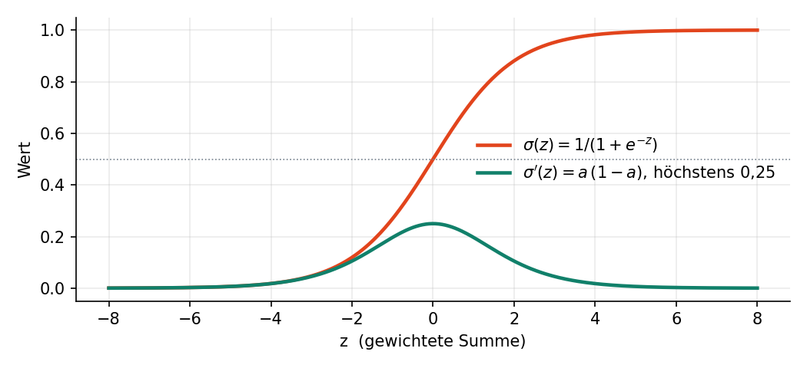{#fig-sigmoid width=80%}

## Kostenfunktion

Der Fehler eines Samples wird mit dem quadratischen Fehler gemessen (Mean Squared Error).
Trainiert wird mit Stochastic Gradient Descent (SGD), also nach jedem einzelnen Sample:

$$
J = \frac{1}{2} \sum_i \left(\hat{y}_i - y_i\right)^2
$$ {#eq-kosten}

Der Faktor $\tfrac12$ kürzt sich beim Ableiten mit der 2 aus dem Quadrat.

## Backpropagation

Gesucht sind die vier Gradienten $\partial J/\partial W^{[2]}$, $\partial J/\partial b^{[2]}$,
$\partial J/\partial W^{[1]}$ und $\partial J/\partial b^{[1]}$. Nach der Kettenregel werden die
Ableitungen entlang des Rechenwegs multipliziert. Für die Ausgabeschicht:

$$
\frac{\partial J}{\partial A^{[2]}} = A^{[2]} - Y, \qquad
\frac{\partial A^{[2]}}{\partial Z^{[2]}} = A^{[2]}\left(1 - A^{[2]}\right), \qquad
\frac{\partial Z^{[2]}}{\partial W^{[2]}} = A^{[1]}
$$

Das Produkt der ersten beiden Faktoren heißt *Delta* (Fehler an der gewichteten Summe):

$$
\delta^{[2]} = \frac{\partial J}{\partial Z^{[2]}} = \left(A^{[2]} - Y\right) \odot A^{[2]}\left(1 - A^{[2]}\right)
$$ {#eq-delta2}

$$
\frac{\partial J}{\partial W^{[2]}} = \delta^{[2]} \, {A^{[1]}}^{\top}, \qquad
\frac{\partial J}{\partial b^{[2]}} = \delta^{[2]}
$$ {#eq-grad2}

Für die Hidden-Schicht kommt der Fehler über die Gewichte der Ausgabeschicht zurück, weil
$\partial Z^{[2]}/\partial A^{[1]} = W^{[2]}$:

$$
\delta^{[1]} = \left({W^{[2]}}^{\top} \delta^{[2]}\right) \odot A^{[1]}\left(1 - A^{[1]}\right), \qquad
\frac{\partial J}{\partial W^{[1]}} = \delta^{[1]} X^{\top}, \qquad
\frac{\partial J}{\partial b^{[1]}} = \delta^{[1]}
$$ {#eq-grad1}

::: {.callout-important}
## Reihenfolge entscheidet
$\delta^{[1]}$ braucht $W^{[2]}$ **vor** dem Update. Wer zuerst die Gewichte der Ausgabeschicht
ändert und dann zurückrechnet, rechnet die Kettenregel mit falschen Werten. Der Code berechnet
den Fehler für die Vorschicht deshalb immer, bevor er die Gewichte anpasst (@sec-backward-code).
:::

## Gewichtsupdate

Jeder Parameter wird ein kleines Stück gegen seinen Gradienten verschoben; die Schrittweite ist
die Lernrate $\alpha$:

$$
W \leftarrow W - \alpha \frac{\partial J}{\partial W}, \qquad b \leftarrow b - \alpha \frac{\partial J}{\partial b}
$$ {#eq-update}

## Erweiterungen der Theorie

**Momentum** merkt sich die letzte Änderung $v$ und rechnet sie teilweise wieder ein
($\beta$ = 0,9 bedeutet: 90 % der bisherigen Richtung bleiben):

$$
v \leftarrow \beta v - \alpha \, g, \qquad W \leftarrow W + v
$$ {#eq-momentum}

**Xavier/Glorot-Initialisierung** wählt die Streuung der Startgewichte passend zur Schichtgröße:
$\sigma_W = \sqrt{2 / (n_\text{ein} + n_\text{aus})}$.

**Softmax und Cross-Entropy** (für die Ziffernerkennung, @sec-ziffern): Softmax macht aus den
Summen einer ganzen Schicht eine Wahrscheinlichkeitsverteilung, Cross-Entropy bestraft eine
niedrige Wahrscheinlichkeit für die richtige Klasse:

$$
a_i = \frac{e^{z_i}}{\sum_j e^{z_j}}, \qquad J = -\sum_j y_j \log a_j
$$ {#eq-softmax}

Weil jedes $a_j$ von allen $z_i$ abhängt, braucht die Kettenregel die ganze Jacobi-Matrix:

$$
\frac{\partial a_j}{\partial z_i} = a_j\left(\mathbb{1}[i=j] - a_i\right) \quad\Rightarrow\quad
\frac{\partial J}{\partial z_i} = a_i\left(\frac{\partial J}{\partial a_i} - \sum_j \frac{\partial J}{\partial a_j}\, a_j\right)
$$ {#eq-jacobi}

Setzt man $\partial J/\partial a_j = -y_j/a_j$ der Cross-Entropy ein, bleibt wegen $\sum_j y_j = 1$
nur $\partial J/\partial z = a - y$ übrig, dasselbe einfache Delta wie bei MSE ohne Aktivierung.

# Implementierung in Python (Part 1) {#sec-python}

## Struktur

Der Kern liegt im Paket `nn/`. numpy wird nur für Vektorrechnung und Zufallszahlen verwendet;
Forward-Pass, Ableitungen und Gradientenabstieg sind selbst geschrieben.

| Datei | Inhalt |
|---|---|
| `nn/activations.py` | sigmoid, tanh, relu, linear, softmax und Ableitungen; Auswahl über den Namen |
| `nn/neuron.py` | `Neuron`: $a = f(w \cdot x + b)$, Update, Mini-Batch und Momentum |
| `nn/layer.py` | `Layer`: Forward, Backward (Kettenregel), Softmax über die Schicht |
| `nn/network.py` | `NeuralNetwork`: `train`, `predict`, `backward`, Kostenfunktionen |
| `nn/persistence.py` | Export und Import: JSON, TXT, C-Header |

: Aufbau des Pakets `nn/` {#tbl-paket}

Die Angabe rechnet mit Matrizen pro Schicht, der Code Neuron für Neuron. Die Übersetzung:

| Angabe | Code | Bedeutung |
|---|---|---|
| $A^{[l-1]}$ bzw. $X$ | `neuron._last_inputs` | Eingänge des Neurons |
| Zeile von $W^{[l]}$ | `neuron.weights` | Gewichte eines Neurons |
| Eintrag von $b^{[l]}$ | `neuron.bias` | Bias |
| Eintrag von $Z^{[l]}$ | `neuron._last_raw` | gewichtete Summe $z$ |
| Eintrag von $A^{[l]}$ | `neuron._last_output` | Ausgabe $a = f(z)$ |
| $\delta^{[l]}$ | `delta` in `Layer.backward` | $\partial J / \partial z$ |

: Schreibweise der Angabe und Namen im Code {#tbl-schreibweise}

## Neuron: Forward und Update

```python
def activate(self, inputs):
    inputs = np.array(inputs)
    self._last_inputs = inputs
    # z = w · x + b   -> eine Zeile von  Z[l] = W[l] · A[l-1] + b[l]
    self._last_raw = np.dot(inputs, self.weights) + self.bias
    # a = f(z)        -> ein Eintrag von  A[l] = f(Z[l])
    self._last_output = self.activation(self._last_raw)
    return self._last_output

def update(self, delta, learning_rate):
    # dJ/dw = delta · x  und  dJ/db = delta · 1   (Angabe: dZ/dW = A[l-1], dZ/db = 1)
    self.weights -= learning_rate * delta * self._last_inputs
    self.bias -= learning_rate * delta
```

## Layer: Backpropagation {#sec-backward-code}

`Layer.backward` setzt @eq-delta2 bis @eq-grad1 um. Der entscheidende Punkt ist Schritt 2:
Der Fehler für die Vorschicht wird mit den **alten** Gewichten berechnet.

```python
# 1) Deltas: delta = dJ/dA · f'(z)
deltas = [error * neuron.derivative() for neuron, error in zip(self.neurons, errors)]

# 2) Fehler für die Vorschicht: Summe über alle Neuronen von delta_i · w_i
#    WICHTIG: mit den ALTEN Gewichten, also vor dem Update
prev_errors = np.zeros(self.num_inputs)
for neuron, delta in zip(self.neurons, deltas):
    prev_errors += delta * neuron.weights

# 3) Erst jetzt Gewichte und Biases anpassen
for neuron, delta in zip(self.neurons, deltas):
    neuron.update(delta, learning_rate)
return prev_errors
```

## Aktivierungen über den Namen

Ein Funktionsobjekt lässt sich nicht in eine JSON-Datei schreiben. Deshalb hat jede Aktivierung
einen Namen, und eine Registry liefert die passenden Funktionen. Alle Ableitungen haben die
Signatur `derivative(z, a)`: Sigmoid und tanh nehmen die gespeicherte Ausgabe $a$, ReLU braucht $z$,
weil $a = 0$ nicht verrät, ob $z$ negativ oder genau 0 war.

```python
ACTIVATIONS = {
    "sigmoid": (sigmoid, sigmoid_derivative),   # a · (1 - a)
    "tanh": (tanh, tanh_derivative),            # 1 - a²
    "relu": (relu, relu_derivative),            # 1 für z > 0
    "linear": (linear, linear_derivative),
    "softmax": (linear, linear_derivative),     # Neuron gibt z weiter, der Layer normiert
}
```

## Startgewichte: gemessen statt angenommen

Ursprünglich sollte Xavier die Standard-Initialisierung werden. Eine Messung über 100 Seeds zeigte
das Gegenteil: Beim XOR-Netz 2-2-1 bleiben mit Xavier 24 von 100 Läufen dauerhaft in einem lokalen
Minimum hängen, mit kleinen Startgewichten ($\sigma$ = 0,1) nur 7. Standard bleibt daher
`init="klein"`; Xavier ist als Option vorhanden (@sec-experimente).

## Export und Import (Steps 4–6) {#sec-export}

Alle drei Formate schreiben jede Zahl als kürzeste Dezimaldarstellung, die beim Einlesen wieder
exakt denselben double-Wert ergibt (`repr`). Python, C (`strtod`) und der C-Compiler runden
Dezimalzahlen korrekt; dadurch sind die Gewichte nach jedem Export **bit-identisch**. Mit `%.6f`
hätte jedes Gewicht bis zu 5·10⁻⁷ Fehler.

**JSON** (`models/xor.json`, gekürzt):

```json
{
  "layer_sizes": [2, 2, 1],
  "learning_rate": 0.1,
  "layers": [
    { "activation": "sigmoid",
      "neurons": [
        { "bias": 6.06586432921751,   "weights": [-4.099769290988828, -4.109435034086112] },
        { "bias": 2.2666433275357676, "weights": [-5.860881390278769, -5.918335628062162] } ] },
    { "activation": "sigmoid",
      "neurons": [
        { "bias": -3.7342474438072357, "weights": [8.083574533730397, -8.353200840676713] } ] }
  ]
}
```

**TXT** (`models/xor.txt`, gekürzt): menschenlesbar und gleichzeitig das Eingabeformat für C.
Zeilen mit `#` sind Kommentare, alle anderen enthalten nur Zahlen.

```text
# Anzahl der Schichten
2

# ---- Schicht 0 (Hidden): 2 Neuronen, je 2 Eingaenge, sigmoid
2 2 sigmoid
#                       Bias               Gewicht 0               Gewicht 1
# Neuron 0
            6.06586432921751      -4.099769290988828      -4.109435034086112
# Neuron 1
          2.2666433275357676      -5.860881390278769      -5.918335628062162
```

**C-Header** (`models/xor_net.h`, gekürzt): Konstanten plus eine Funktion `nn_init_from_header()`,
die damit ein Netz aufbaut.

```c
#define NN_NUM_LAYERS 2
static const int NN_LAYER_SIZES[NN_NUM_LAYERS + 1] = {2, 2, 1};
static const NnActivation NN_ACTIVATIONS[NN_NUM_LAYERS] = {NN_ACT_SIGMOID, NN_ACT_SIGMOID};

static const double NN_L0_BIASES[2] = { 6.06586432921751, 2.2666433275357676 };
static const double NN_L0_WEIGHTS[2][2] = {
    {-4.099769290988828, -4.109435034086112},   /* Neuron 0 */
    {-5.860881390278769, -5.918335628062162},   /* Neuron 1 */
};
```

# Training und Persistenz (Part 2) {#sec-training}

## XOR

Netz 2-2-1, 20 000 Epochen, $\alpha$ = 0,1, SGD in fester Reihenfolge, Seed 1. Nach dem Export
wird das Netz aus der JSON-Datei geladen und erneut getestet; die Abweichung zum trainierten Netz
ist exakt 0.

| Eingabe | Soll | Ausgabe nach dem Training | nach dem Laden | gerundet |
|---|:---:|---:|---:|:---:|
| [0, 0] | 0 | 0,037759 | 0,037759 | 0 ✓ |
| [0, 1] | 1 | 0,958389 | 0,958389 | 1 ✓ |
| [1, 0] | 1 | 0,958241 | 0,958241 | 1 ✓ |
| [1, 1] | 0 | 0,052827 | 0,052827 | 0 ✓ |

: XOR vor und nach Export/Import (Kosten 9,6·10⁻⁴) {#tbl-xor}

## 7-Segment-Decoder

Eingabe ist die Ziffer 0–9 als 4-Bit-Zahl (höchstwertiges Bit zuerst), Ausgabe die Segmente a–g.
Die Trainingsdaten sind die Tabelle von Seite 10 der Angabe. Netz 4-16-7, 20 000 Epochen,
$\alpha$ = 0,1.

| Ziffer | Eingabe | Segmente a b c d e f g |
|:---:|:---:|:---:|
| 0 | 0000 | 1 1 1 1 1 1 0 |
| 1 | 0001 | 0 1 1 0 0 0 0 |
| 2 | 0010 | 1 1 0 1 1 0 1 |
| 3 | 0011 | 1 1 1 1 0 0 1 |
| 4 | 0100 | 0 1 1 0 0 1 1 |
| 5 | 0101 | 1 0 1 1 0 1 1 |
| 6 | 0110 | 1 0 1 1 1 1 1 |
| 7 | 0111 | 1 1 1 0 0 0 0 |
| 8 | 1000 | 1 1 1 1 1 1 1 |
| 9 | 1001 | 1 1 1 1 0 1 1 |

: Trainingsdaten des 7-Segment-Decoders {#tbl-7seg}

**Ergebnis:** 70/70 Segmente und 10/10 Ziffern richtig (Schwelle 0,5), Kosten 4,4·10⁻⁴,
kleinste Sicherheit 95,6 %, Trainingsdauer 33 s. Nach dem Laden aus JSON und TXT: Abweichung 0.

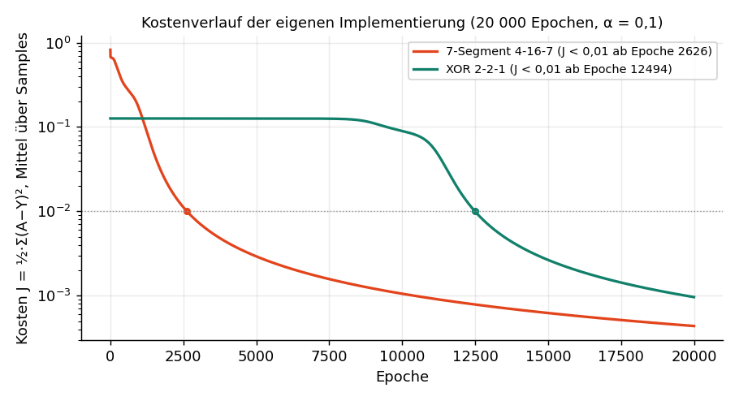{#fig-verlauf width=95%}

# Vergleich mit TensorFlow (Part 3) {#sec-tf}

TensorFlow 2.21 läuft nicht unter Python 3.14 und wurde deshalb in einem eigenen venv mit
Python 3.12 installiert. Verglichen werden zwei Varianten:

- **TF identisch:** dieselben Startgewichte wie die eigene Implementierung, dieselbe
  Kostenfunktion $\tfrac12\sum(A-Y)^2$, float64. TensorFlow bildet die Gradienten per
  automatischer Differentiation, also völlig unabhängig vom eigenen Code.
- **TF Standard:** Keras-Voreinstellungen (Glorot-Initialisierung, Keras-MSE, float32).

Die Angabe nennt für TensorFlow "z. B. 10" Hidden-Neuronen, Part 2 aber 16. Trainiert wurden
beide Größen.

| Netz | Lauf | Kosten J | richtig | J < 0,01 ab Epoche | Dauer |
|---|---|---:|---:|---:|---:|
| 2-2-1 | eigen | 9,6·10⁻⁴ | 4/4 | 12 494 | 2,6 s |
| | TF identisch | 9,6·10⁻⁴ | 4/4 | 12 494 | 11,5 s |
| | TF Standard | 8,4·10⁻² | **3/4** | nie | 11,5 s |
| 4-16-7 | eigen | 4,4·10⁻⁴ | 70/70 | 2 626 | 33,2 s |
| | TF identisch | 4,4·10⁻⁴ | 70/70 | 2 626 | 17,9 s |
| | TF Standard | 2,5·10⁻³ | 70/70 | 9 166 | 19,0 s |
| 4-10-7 | eigen | 6,1·10⁻⁴ | 70/70 | 2 991 | 26,2 s |
| | TF identisch | 6,1·10⁻⁴ | 70/70 | 2 991 | 16,7 s |
| | TF Standard | 2,7·10⁻³ | 70/70 | 9 243 | 18,8 s |

: Eigene Implementierung gegen TensorFlow, 20 000 Epochen, α = 0,1, SGD {#tbl-tf}

**Auswertung:**

- *TF identisch* liefert Epoche für Epoche dieselben Werte (maximal 1,4·10⁻¹⁶ Abweichung) und
  erreicht $J$ < 0,01 in derselben Epoche. Das ist ein unabhängiger Nachweis, dass die eigene
  Backpropagation stimmt.
- *TF Standard* lernt langsamer, weil die Keras-MSE zusätzlich durch die Zahl der Ausgänge teilt
  (effektiv kleinere Lernrate). Bei XOR landet es in einem lokalen Minimum (3/4).
- Geschwindigkeit: Bei XOR ist die eigene Implementierung schneller, weil TensorFlow pro Schritt
  einen festen Verwaltungsaufwand hat; bei den größeren 7-Segment-Netzen holt TensorFlow auf.

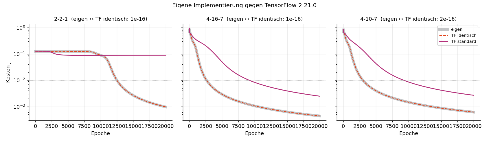{#fig-tf width=95%}

# Forward-Pass in C (Part 4 und 5) {#sec-c}

## Datenstrukturen

Wie in der Angabe gefordert, gibt es nur Forward und Predict, kein Training:

```c
typedef struct {
    double *weights;   /* Länge num_inputs. Besitz: Neuron */
    int num_inputs;
    double bias;
    double output;     /* a = f(z) aus dem letzten nn_forward() */
} Neuron;

typedef struct {
    Neuron *neurons;          /* Besitz: Layer */
    double *outputs;          /* A[l] als Vektor, Eingang der nächsten Schicht */
    int num_neurons, num_inputs;
    NnActivation activation;
} Layer;

typedef struct { Layer *layers; int num_layers, num_inputs, num_outputs; } Network;
```

## Forward-Pass

```c
const double *nn_forward(Network *net, const double *input)
{
    const double *x = input;                       /* zuerst X = A[0] */
    for (int l = 0; l < net->num_layers; l++) {
        Layer *layer = &net->layers[l];
        for (int k = 0; k < layer->num_neurons; k++) {
            Neuron *neuron = &layer->neurons[k];
            double z = 0.0;                        /* z = w · x + b */
            for (int j = 0; j < neuron->num_inputs; j++) z += neuron->weights[j] * x[j];
            z += neuron->bias;
            neuron->output = activate(layer->activation, z);
            layer->outputs[k] = neuron->output;
        }
        x = layer->outputs;   /* erst nach der ganzen Schicht umschalten */
    }
    return x;
}
```

## Zwei Wege zur Initialisierung

- **Part 4:** `nn_load_txt()` liest die TXT-Datei aus @sec-export in zwei Durchgängen (erst
  Struktur prüfen und Größen sammeln, dann die Zahlen). Kaputte Dateien werden mit Zeilennummer
  und Exit-Code 2 abgelehnt.
- **Part 5:** `nn_init_from_header()` aus `7seg_net.h` kopiert die Konstanten in dieselben
  Strukturen. Part 5 kompiliert `nn_forward.c` aus Part 4 mit, es gibt keinen kopierten Code.

Beide Programme kompilieren mit `gcc -Wall -Wextra -Werror` ohne Warnung (MinGW-w64), erkennen
70/70 Segmente und weichen höchstens 2,2·10⁻¹⁶ von Python ab. Die eine Binärstelle Unterschied
entsteht, weil numpy Summen in anderer Reihenfolge bildet.

# Interaktive Visualisierung (Ersatz für Part 6) {#sec-visualisierung}

Die Seite `visualisierung/index.html` ist eine einzige Datei ohne Installation und ohne
Internetzugang (außer Schriften). `export_daten.py` schreibt Gewichte, Trainingsprotokolle und
Vergleichswerte aus Python, C und TensorFlow hinein; den Forward-Pass rechnet die Seite in
JavaScript selbst. Sie ist in fünf Bereiche gegliedert, von denen immer nur ein Kapitel sichtbar ist.

## Decoder

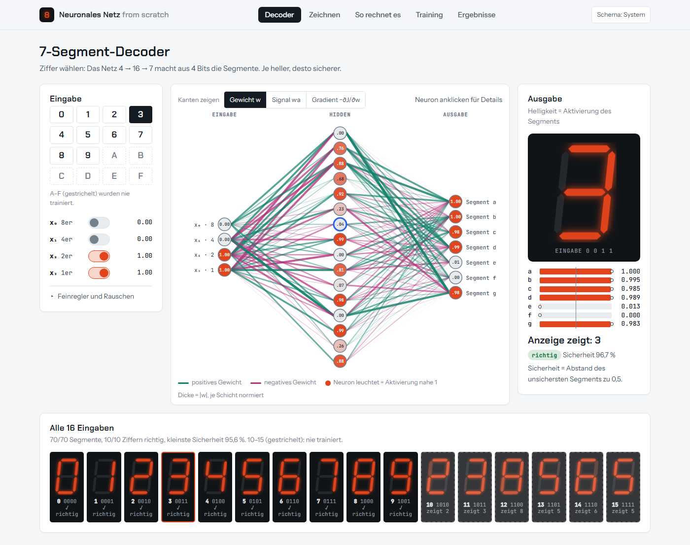{#fig-decoder}

## So rechnet das Netz

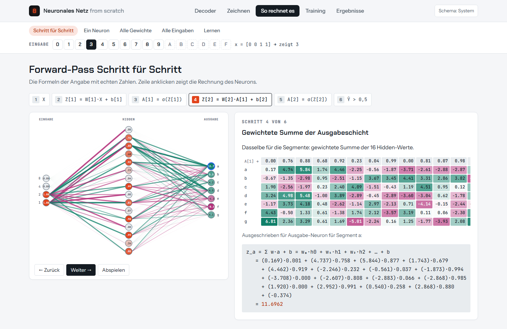{#fig-rechenweg}

{#fig-neuron}

![Alle 199 Parameter als Matrizen $W^{[1]}$, $b^{[1]}$ und $W^{[2]}$, $b^{[2]}$. Teal = positiv (verstärkt), Magenta = negativ (hemmt).](bilder/seite_gewichte.png){#fig-gewichte}

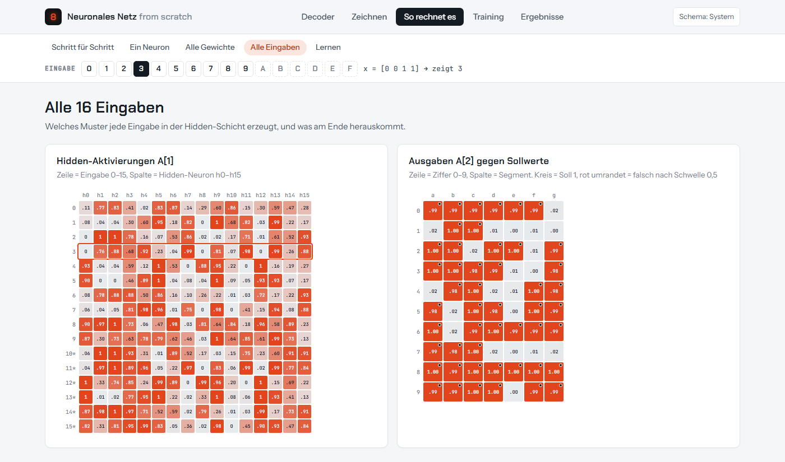{#fig-ziffern}

![Ein Lernschritt: Fehler an der Ausgabe ($\delta^{[2]}$, @eq-delta2), Rückführung in die Hidden-Schicht ($\delta^{[1]}$, @eq-grad1), Gradienten aller Gewichte und Probeschritte auf einer Kopie des Netzes.](bilder/seite_backprop.png){#fig-backprop}

## Training

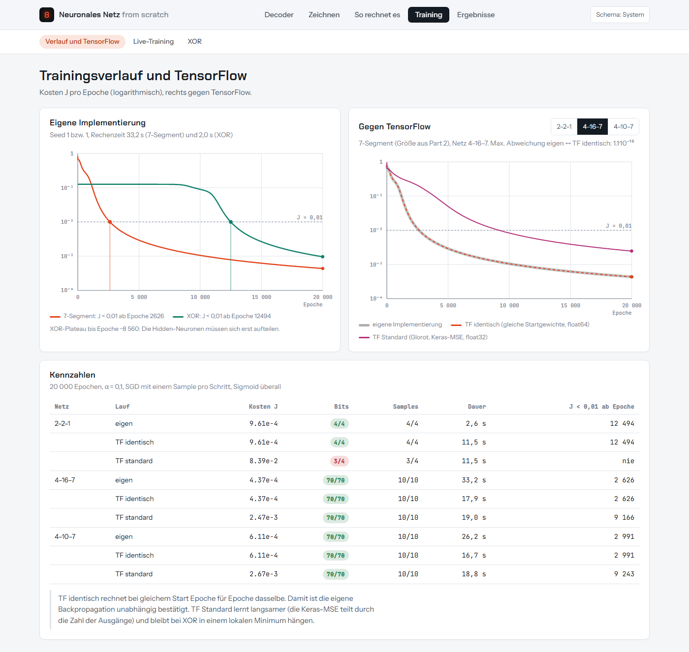{#fig-seite-training}

{#fig-live}

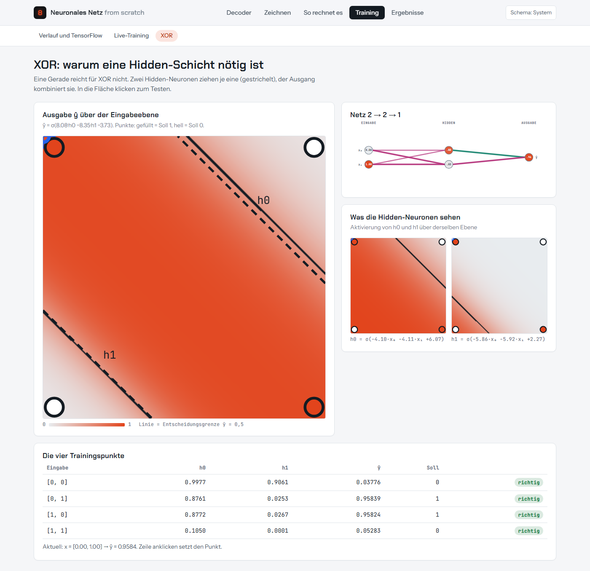{#fig-xor}

## Ergebnisse

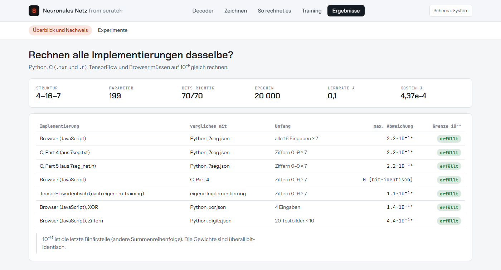{#fig-nachweis}

# Erweiterungen und Experimente {#sec-experimente}

## Bonus-Aufgaben

| Bonus aus der Angabe | Umsetzung |
|---|---|
| andere Aktivierungen (ReLU, tanh) | Registry in `nn/activations.py`, pro Schicht wählbar |
| Mini-Batch-Training | `train(..., batch_size=n)`: Gradienten sammeln, gemittelt anwenden |
| Momentum | `train(..., momentum=β)`, @eq-momentum |
| Testsuite | 70 Tests mit `pytest` (@sec-tests) |

: Bonus-Aufgaben {#tbl-bonus}

Mini-Batch und Momentum laufen über einen eigenen Codepfad. Ein gemeinsamer Pfad mit $\beta = 0$
würde mathematisch dasselbe rechnen, aber in anderer Reihenfolge, und die Bit-Gleichheit mit dem
Ausgangsstand ginge verloren. Messung an XOR (Seed 1), Epoche bis $J$ < 0,01:

| Verfahren | Epoche |
|---|---:|
| SGD (Angabe) | 12 494 |
| SGD + Momentum 0,5 | 6 191 |
| SGD + Momentum 0,9 | 1 310 |
| Full-Batch ohne Momentum | nie (Plateau J ≈ 0,125) |
| Full-Batch + Momentum 0,9 | 11 941 |

: Momentum und Mini-Batch bei XOR {#tbl-momentum}

## Seed-Studie: lokale Minima bei XOR

Für die Studien werden viele Netze gleichzeitig als Matrix-Stapel trainiert (`experimente/parallel.py`);
die Startgewichte kommen aus `nn/`, die Abweichung zu `nn/` ist ≤ 9·10⁻¹⁶.

| 100 Seeds | 2-2-1 klein | 2-2-1 Xavier | 2-3-1 klein | 2-3-1 Xavier | 2-4-1 klein | 2-4-1 Xavier |
|---|---:|---:|---:|---:|---:|---:|
| richtig (20 000 Ep.) | 86 | 75 | 96 | 99 | 99 | 100 |
| hängt fest (80 000 Ep.) | 7 | 24 | 0 | 0 | 0 | 0 |
| Median bis J < 0,01 | 15 919 | 5 790 | 16 220 | 4 960 | 15 800 | 4 800 |

: Erfolgsquote nach Netzgröße und Initialisierung {#tbl-seed}

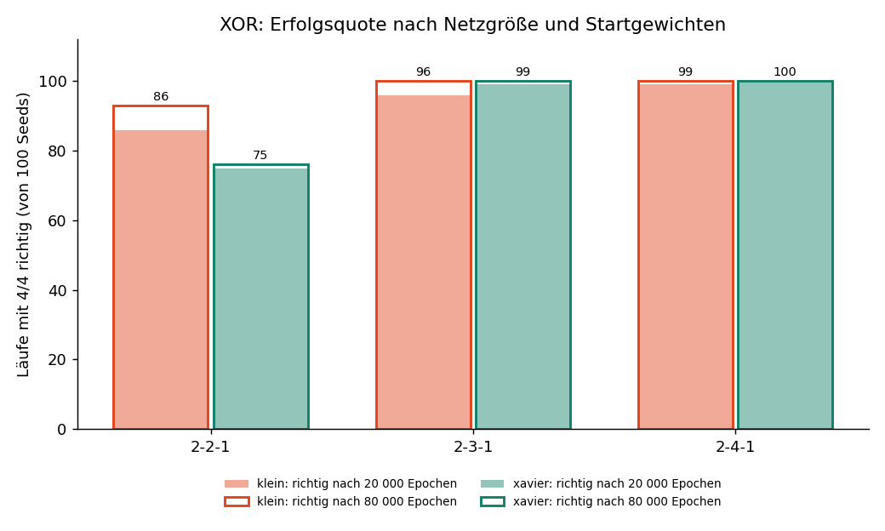{#fig-seed width=85%}

## Aktivierungsfunktionen

Beim 7-Segment-Netz lernen tanh und ReLU in der Hidden-Schicht 4–6× schneller als Sigmoid, weil
ihre Ableitung nicht auf 0,25 begrenzt ist. Bei XOR 2-2-1 scheitern sie dagegen meist: Es gibt
keine Reserve, und ReLU-Neuronen "sterben" ($z < 0$ für alle Eingaben, Gradient 0).

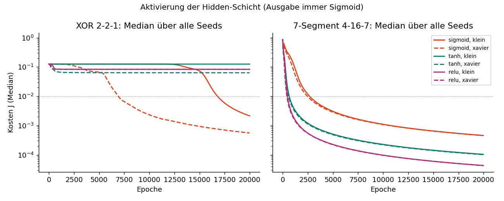{#fig-akt width=95%}

## Robustheit gegen Rauschen

Mit Rauschen $\mathcal{N}(0, \sigma)$ auf den Eingangsbits erkennt das Modell aus Part 2 bei
$\sigma$ = 0,2 noch 78,5 % der Ziffern vollständig richtig, ein mit Rauschen trainiertes Netz
95,6 %. Gekippte Bits im Training helfen dagegen nicht: Bei 4 Bit ergibt jedes gekippte Bit eine
andere gültige Zahl, die Beispiele widersprechen sich (bei $p$ = 0,2 nur noch 77 %).

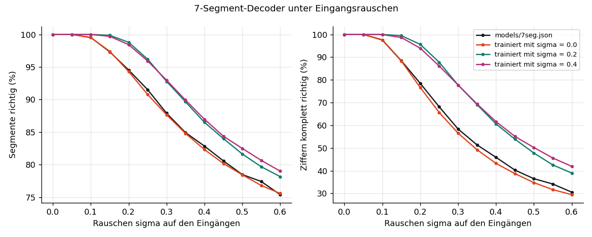{#fig-rauschen width=95%}

## Objekte gegen Matrizen

| Netz | Neuron-für-Neuron (`nn/`) | vektorisiert | Faktor |
|---|---:|---:|---:|
| XOR 2-2-1, 20 000 Epochen | 1,6 s | 2,4 s | 0,6× |
| 7-Segment 4-16-7, 20 000 Epochen | 28,0 s | 7,4 s | 3,8× |
| 7-Segment 4-64-7, 5 000 Epochen | 19,0 s | 1,9 s | 9,7× |

: Laufzeit der objektorientierten gegen eine vektorisierte Variante {#tbl-vektor}

Beide rechnen dasselbe (Abweichung 2·10⁻¹⁶). Matrizen lohnen sich erst bei breiten Schichten.
`nn/` bleibt objektorientiert, weil die Angabe die Klassen Neuron/Layer verlangt und der Code
dadurch nachvollziehbar bleibt.

# Ziffernerkennung mit MNIST {#sec-ziffern}

## Idee

Als Erweiterung erkennt ein zweites Netz handgeschriebene Ziffern, die man auf der Seite mit
Maus, Stift oder Finger zeichnet. Dafür kamen Softmax und Cross-Entropy (@eq-softmax) in das
Paket `nn/`. Die Neuron/Layer-Struktur bleibt erhalten: Jedes Neuron einer Softmax-Schicht gibt
nur seine Summe $z$ weiter, der Layer normiert den Vektor und verwendet in `backward` die
Jacobi-Matrix aus @eq-jacobi. Ein Gradient-Check bestätigt alle Kombinationen auf < 10⁻⁶.

## Daten und Training

- **Daten:** MNIST, 60 000 Trainings- und 10 000 Testbilder von rund 500 Schreibern, von 28×28 auf
  14×14 Pixel verkleinert (je 2×2 gemittelt). Die Testbilder stammen von anderen Schreibern.
- **Netz:** 196 → 64 (Sigmoid) → 10 (Softmax), Cross-Entropy, Xavier-Startgewichte.
- **Training:** SGD, $\alpha$ = 0,05, 15 Epochen, Reihenfolge jede Epoche gemischt, 314 s.
- **Ergebnis:** **97,70 %** auf den 10 000 Testbildern, 99,04 % auf den Trainingsbildern.

Ein erster Versuch mit dem kleinen UCI-Datensatz (1 797 Bilder, 8×8) erreichte 96,7 %, erkannte
gezeichnete Ziffern aber unzuverlässig. MNIST hat 40× mehr Beispiele, und seine Aufbereitung ist
genau dokumentiert. Das ist für das Zeichnen entscheidend.

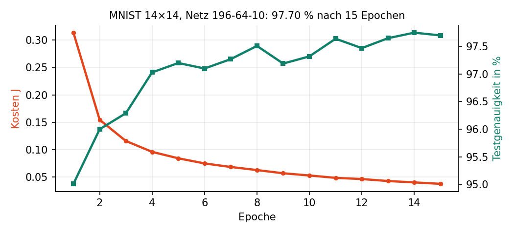{#fig-mnist-verlauf width=85%}

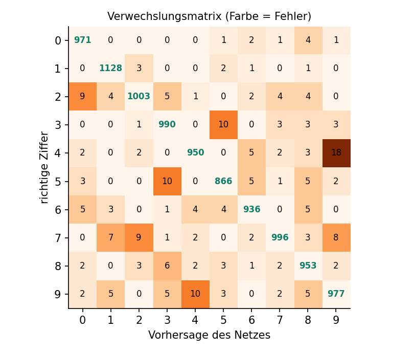{#fig-mnist-matrix width=65%}

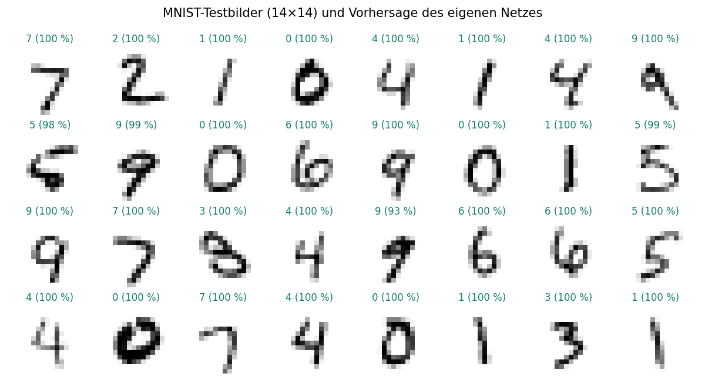{#fig-mnist-beispiele width=95%}

## Zeichnung wie MNIST aufbereiten

Damit eine Zeichnung so aussieht wie die Trainingsbilder, wiederholt die Seite die
MNIST-Aufbereitung:

1. Die längere Seite der Ziffer wird auf 20 Pixel skaliert. Wie groß man malt, spielt keine Rolle.
2. Der Strich wird mit fester Breite (2,7 Pixel) auf 28×28 gerendert. Bei MNIST ist die
   Strichstärke gleich, die Tintenmenge hängt von der Ziffer ab (gemessen: eine 1 hat 60, eine 0
   hat 136 Pixel Tinte).
3. Die Ziffer wird verschoben, bis ihr Schwerpunkt in der Mitte liegt (Pixel 14, 14).
4. Je 2×2 Pixel werden gemittelt, wie beim Training → 14×14.

Getestet mit elf synthetisch gezeichneten Ziffern (je einmal groß und klein in einer Ecke): alle
richtig, meist mit 97–100 % Sicherheit.

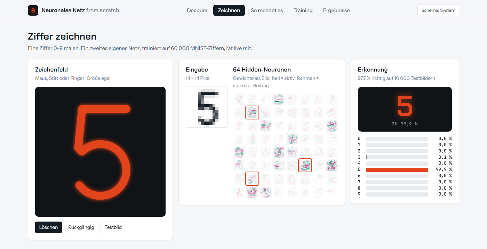{#fig-zeichnen}

# Tests und Nachweis {#sec-tests}

## Automatische Tests

| Datei | Tests | Inhalt |
|---|---:|---|
| `tests/test_kern.py` | 30 | Ableitungen, Gradient-Check, Bit-Gleichheit mit dem Ausgangsstand, Datensätze, Fehlermeldungen |
| `tests/test_persistenz.py` | 24 | JSON/TXT/Header-Roundtrip, kaputte Dateien, Mini-Batch und Momentum |
| `tests/test_c.py` | 3 | C aus TXT und Header gegen Python |
| `tests/test_softmax.py` | 13 | Softmax, Cross-Entropy, Gradient-Check, Export |

: Testsuite, alle 70 Tests grün {#tbl-tests}

## Gradient-Check

Der wichtigste Test vergleicht die Gradienten der Backpropagation mit einer numerischen
Ableitung, die nur Forward-Passes benutzt und nichts von Kettenregel oder Deltas weiß:

$$
\frac{\partial J}{\partial w} \approx \frac{J(w + h) - J(w - h)}{2h}, \qquad h = 10^{-6}
$$ {#eq-gradcheck}

Die analytischen Gradienten werden ohne Umbau des Codes gewonnen: `backward()` läuft auf einer
Kopie mit $\alpha = 1$, dann gilt $\partial J/\partial W = W_\text{alt} - W_\text{neu}$. Geprüft
werden fünf Architekturen, darunter 4-16-7 und ein Netz mit zwei Hidden-Schichten. Maximale
Abweichung: 7·10⁻¹¹.

Damit der Test nicht nur "grün" ist, wurde er gegen zwei absichtlich eingebaute Fehler geprüft.
Er erkennt beide: "Update vor Fehlerberechnung" (Abweichung 5·10⁻³) und "Ableitung vergessen"
(0,74).

## Gleichheit aller Implementierungen

| Implementierung | verglichen mit | max. Abweichung |
|---|---|---:|
| Browser (JavaScript) | Python, 16 Eingaben × 7 | 2,2·10⁻¹⁶ |
| C, Part 4 (aus `.txt`) | Python | 2,2·10⁻¹⁶ |
| C, Part 5 (aus `.h`) | Python | 2,2·10⁻¹⁶ |
| Browser | C, Part 4 | 0 (bit-identisch) |
| TensorFlow identisch | eigene Implementierung | 1,1·10⁻¹⁶ |
| Browser, XOR | Python | 1,4·10⁻¹⁷ |
| Browser, Ziffern | Python, 20 Testbilder × 10 | 4,4·10⁻¹⁶ |

: Alle Abweichungen liegen in der letzten Binärstelle einer double-Zahl {#tbl-gleichheit}

# Fazit

Alle Pflichtteile der Angabe (Part 1–5) und alle Bonus-Aufgaben sind umgesetzt und durch Messungen
belegt. Die stärksten Nachweise sind unabhängig voneinander: der numerische Gradient-Check, die
Übereinstimmung mit TensorFlow (automatische Differentiation) und die bit-genaue Gleichheit von
Python, C und Browser. Part 6 wurde bewusst durch eine Visualisierung ersetzt, die den Rechenweg
sichtbar macht.

Zwei Messungen haben ursprüngliche Annahmen widerlegt: Xavier ist beim Netz der Angabe nicht
zuverlässiger als kleine Startgewichte, und ein größerer Datensatz verbesserte die
Ziffernerkennung weniger über die Testgenauigkeit (96,7 → 97,7 %) als über die Erkennung
gezeichneter Ziffern, weil sich die Aufbereitung genau nachbauen ließ.

# Anhang {.appendix}

## Reproduktion

Voraussetzung: Python 3.14 mit numpy, pytest und matplotlib; für Part 3 ein venv mit Python 3.12
und TensorFlow; für Part 4/5 gcc (MinGW-w64). MNIST wird einmalig über das TensorFlow-venv geladen
(`keras.datasets.mnist.load_data()`). `python` startet auf diesem Rechner Python 3.12, deshalb `py -3.14`.

```bash
py -3.14 train_xor.py                  # Part 2, Step 1
py -3.14 test_xor_load.py              # Part 2, Step 2
py -3.14 train_7seg.py                 # Part 2, Step 3
py -3.14 test_7seg_load.py             # Part 2, Step 4
py -3.14 train_digits.py               # Ziffernerkennung (MNIST, ~5 min)
py -3.14 -m pytest -v                  # 70 Tests
.venv-tf\Scripts\python compare_tensorflow.py      # Part 3
cd c_forward     && mingw32-make && nn_txt ../models/7seg.txt   # Part 4
cd c_header_init && mingw32-make && nn_header                   # Part 5
py -3.14 visualisierung/export_daten.py            # Visualisierung
py -3.14 dokumentation/screenshots.py              # Screenshots für diese Doku
py -3.14 dokumentation/abbildungen.py              # zusätzliche Abbildungen
quarto render dokumentation/dokumentation.qmd      # diese Doku als HTML und PDF
```

## Projektstruktur

```text
nn/                     Kern: activations, neuron, layer, network, persistence
datasets.py             XOR- und 7-Segment-Tabelle aus der Angabe
train_*.py, test_*_load.py   Part 2 und Ziffernerkennung
compare_tensorflow.py   Part 3 (im venv .venv-tf)
c_forward/              Part 4: nn_forward.h/.c, test_7seg.c, main_txt.c
c_header_init/          Part 5: main_header.c (nutzt c_forward/ und models/7seg_net.h)
models/                 exportierte Netze und Trainingsprotokolle
visualisierung/         vorlage.html + export_daten.py -> index.html
experimente/            Studien, Benchmark, Plots
ergebnisse/             JSON und PNG der Experimente und des TF-Vergleichs
tests/                  pytest
dokumentation/          diese Dokumentation (Quarto)
```

## Arbeitsweise

Das Projekt wurde mit KI-Unterstützung (Claude Code) entwickelt. Jede Entscheidung ist mit
Begründung, Messwerten und verworfenen Alternativen in `CLAUDE.md` protokolliert (E-01 bis E-36),
jeder Arbeitsauftrag gekürzt in `Prompts.md`. `Ausgangsstand.md` hält den Code vor Beginn des
Ausbaus fest, `Implementation.md` den Plan mit allen Phasen.
